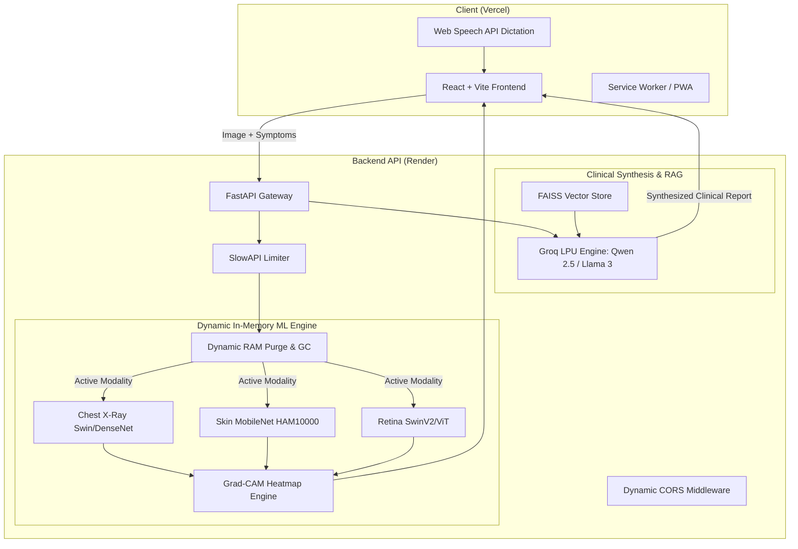

# 🧬 MedAI: Production-Grade Multimodal AI Medical Diagnosis Assistant

[](https://medai-lovat.vercel.app)
[](https://medai-api-tivz.onrender.com/api/v1/health)
[](https://medai-api-tivz.onrender.com/docs)
[](LICENSE)


-005571?style=flat-square&logo=fastapi&logoColor=white)

-F05032?style=flat-square)


---

## 🌐 Live Deployments

| Component | Platform | Live URL | Description |
| :--- | :--- | :--- | :--- |
| **Frontend Application** | **Vercel** | [https://medai-lovat.vercel.app](https://medai-lovat.vercel.app) | Responsive React UI with voice input, Grad-CAM viewer & RAG triage |
| **Backend REST API** | **Render** | [https://medai-api-tivz.onrender.com](https://medai-api-tivz.onrender.com) | FastAPI ML engine serving vision classifiers and clinical LLM pipeline |
| **Interactive API Docs** | **Render** | [https://medai-api-tivz.onrender.com/docs](https://medai-api-tivz.onrender.com/docs) | Swagger UI for testing endpoints directly in the browser |
| **Health Check Endpoint** | **Render** | [https://medai-api-tivz.onrender.com/api/v1/health](https://medai-api-tivz.onrender.com/api/v1/health) | Returns system status and loaded models in memory |

---

## 📋 Table of Contents

- [Overview](#-overview)
- [Key Features](#-key-features)
- [AI & ML Modalities](#-ai--ml-modalities)
- [System Architecture](#-system-architecture)
- [Explainable AI (Grad-CAM)](#-explainable-ai-grad-cam)
- [Cloud Deployment & Memory Optimization](#-cloud-deployment--memory-optimization)
- [24/7 Keep-Alive Automation](#-247-keep-alive-automation)
- [Technology Stack](#-technology-stack)
- [API Endpoints Reference](#-api-endpoints-reference)
- [Local Development Setup](#-local-development-setup)
- [Environment Variables](#-environment-variables)
- [Medical Disclaimer](#-medical-disclaimer)

---

## 🔬 Overview

**MedAI** is an end-to-end, full-stack, multimodal medical diagnosis and triage platform. It empowers clinicians and patients by:
1. Classifying medical imaging across three critical modalities (**Chest X-Ray**, **Skin Lesions**, and **Retinal Fundus Scans**).
2. Generating visual **Grad-CAM saliency heatmaps** so human doctors can see precisely which anatomical regions led to the AI's prediction.
3. Synthesizing visual diagnoses with self-reported patient symptoms using **High-Speed Groq LPUs** to generate structured clinical reports (Findings, Assessment, Plan).
4. Providing a **RAG-powered conversational medical triage chat** allowing interactive follow-up questions backed by clinical literature.
5. Offering **voice-to-text dictation** and **geo-targeted specialist referrals** (e.g., Pulmonologist, Dermatologist, Ophthalmologist).

---

## ✨ Key Features

- **Multi-Modality Vision AI:** Rapid zero-friction switching between Chest X-Rays, Dermatology scans, and Retinal imaging.
- **Explainable AI (Grad-CAM):** Overlays visual gradient heatmaps on the input image to highlight pathological triggers.
- **Instant Clinical Report Generation:** LLM synthesis generates structured diagnostic assessments with immediate differential considerations and treatment pathways.
- **Conversational RAG Chatbot:** Ask questions about reports, medications, precautions, and specialist follow-up.
- **Voice-to-Text Input:** Native Web Speech API integration for hands-free symptom dictation.
- **Dynamic Specialist Locator:** Automatically determines the required clinical specialty based on the diagnostic category and directs users to nearby clinics via Google Maps.
- **Production-Tuned Memory Management:** Dynamic model swapping and garbage collection keeping RAM usage < 250 MB (operating reliably within Render's 512 MB free tier).
- **Automated Keep-Alive:** GitHub Actions automated cron ping keeps the backend active without sleeping during periods of inactivity.
- **Zero-Storage Privacy Policy:** Patient images are processed 100% ephemerally in RAM; no patient data is permanently written to disk or third-party storage.

---

## 🧠 AI & ML Modalities

MedAI supports three specialized computer vision diagnostic pipelines:

### 1. Chest X-Ray (`chest_xray`)
- **Primary Architectures:** Swin Transformer (`nickmuchi/swin-transformer-finetuned-chest-xray-pneumonia`) and DenseNet-121.
- **Conditions Detected:**
  - Tuberculosis (TB)
  - Pneumonia (Bacterial / Viral)
  - COVID-19
  - Normal / Clear Lung Fields

### 2. Dermatology & Skin Lesions (`skin`)
- **Primary Architecture:** MobileNetV2 fine-tuned on the HAM10000 dataset (`Anwarkh1/Skin_Cancer-Image_Classification`).
- **Conditions Detected (7 Classes):**
  - Melanoma (MEL)
  - Melanocytic Nevi / Benign Moles (NV)
  - Basal Cell Carcinoma (BCC)
  - Actinic Keratoses (AKIEC)
  - Benign Keratosis (BKL)
  - Dermatofibroma (DF)
  - Vascular Lesions (VASC)

### 3. Ophthalmology & Retinal Fundus Scans (`retina`)
- **Primary Architectures:** Vision Transformer & SwinV2 (`Ken0965/vit-base-patch16-224-in21k-retinal-disease`, `swin-base-patch4-window7-224-in21k-retinal-disease`).
- **Conditions Detected:**
  - Glaucoma
  - Diabetic Retinopathy (DR)
  - Cataract
  - Pathological Myopia
  - Age-Related Macular Degeneration (AMD)
  - Normal Eye Fundus

---

## 🏗️ System Architecture



---

## 🔍 Explainable AI (Grad-CAM)

Medical AI requires trust and interpretability. MedAI implements **Gradient-weighted Class Activation Mapping (Grad-CAM)**:
1. Calculates the gradients of the target class score with respect to the feature map activations in the final convolutional / patch-projection layer.
2. Generates a coarse localization map highlighting discriminative regions (e.g., lung infiltrates, atypical skin pigment networks, or optic disc cup-to-disc ratio changes).
3. Blends the colormap (`cv2.applyColorMap`) directly over the original grayscale/RGB scan and returns a Base64-encoded image for immediate client display.

---

## ⚙️ Cloud Deployment & Memory Optimization

Deploying multi-gigabyte PyTorch models to cloud free-tiers (like Render's 512 MB RAM limit) typically causes immediate Out-Of-Memory (OOM) crashes. MedAI implements custom architectural optimizations:

1. **Dynamic Single-Active Modality Swapping:**
   - Instead of loading Chest, Skin, and Retina models simultaneously into RAM (>1.5 GB), only the currently requested modality is loaded.
   - When a different modality is called, previous weights are explicitly deleted (`del app.state.models[old_modality]`) followed by explicit Python garbage collection (`gc.collect()`).
   - Keeps total API container RAM under **250 MB**.
2. **Instant Lifespan Startup:**
   - Models are initialized lazily upon the first request rather than during startup, allowing the server to boot in `< 1.2s` and pass cloud health checks immediately.
3. **Resilient Frontend Fallback & Direct Axios Transport:**
   - Frontend calls the Render backend directly with extended timeouts (up to 3 minutes), completely avoiding serverless proxy timeouts.
   - If an LLM synthesis API experiences high latency, the visual prediction and Grad-CAM heatmap remain visible to the user with a clean fallback.

---

## ⏰ 24/7 Keep-Alive Automation

Free tier containers on Render spin down after 15 minutes of inactivity. MedAI includes an automated GitHub Actions workflow to keep the service warm and responsive:

- **Workflow File:** [`.github/workflows/keep_alive.yml`](.github/workflows/keep_alive.yml)
- **Schedule:** Runs every 10 minutes (`*/10 * * * *`).
- **Target:** Pings `https://medai-api-tivz.onrender.com/api/v1/health`.
- **Standalone Script:** [`keep_alive.py`](keep_alive.py) can also be run locally, via systemd, or registered on free external monitors like [cron-job.org](https://cron-job.org) or [UptimeRobot](https://uptimerobot.com).

---

## 🛠️ Technology Stack

| Domain | Technology | Purpose |
| :--- | :--- | :--- |
| **Frontend** | React 18, Vite | Lightning-fast component rendering and HMR |
| **Styling** | Tailwind CSS, Framer Motion | Modern clinical dark/light aesthetics and fluid micro-interactions |
| **Icons** | Lucide React | High-clarity medical and interface icons |
| **Backend** | FastAPI, Uvicorn | High-throughput asynchronous Python web server |
| **ML / DL** | PyTorch, Hugging Face Transformers | State-of-the-art vision models fine-tuned on medical benchmarks |
| **Computer Vision** | OpenCV, PIL, Torchvision | Image preprocessing and Grad-CAM heatmap overlay |
| **LLM Inference** | Groq API (`qwen/qwen-2.5-32b`, `llama-3.3-70b`) | Sub-second medical report synthesis |
| **Vector DB / RAG**| FAISS, LangChain | Contextual medical literature search for follow-up patient triage |
| **Security** | SlowAPI, CORS Regex | Rate limiting, MIME verification, and cross-origin security |

---

## 📡 API Endpoints Reference

Base URL: `https://medai-api-tivz.onrender.com/api/v1`

| Method | Endpoint | Description |
| :--- | :--- | :--- |
| `GET` | `/health` | Service health status, API version, and currently loaded models |
| `POST` | `/predict` | Upload image (`multipart/form-data`) + `modality` -> Returns predictions & Grad-CAM heatmap |
| `POST` | `/report` | Submits symptoms + visual prediction -> Returns structured clinical report |
| `POST` | `/chat` | Interactive multi-turn RAG medical triage chat |
| `GET` | `/specialists` | Recommends medical specialist based on detected pathology |

---

## 💻 Local Development Setup

### Prerequisites
- Python 3.10+
- Node.js 18+ & npm
- Git

### 1. Clone the Repository
```bash
git clone https://github.com/krish2677/MedAI.git
cd MedAI
```

### 2. Configure Backend
```bash
cd backend
python -m venv venv

# Windows:
.\venv\Scripts\activate
# Mac / Linux:
source venv/bin/activate

pip install -r requirements.txt
```

Create a `.env` file inside `backend/`:
```env
PORT=8000
ENVIRONMENT=development
ALLOWED_ORIGINS=http://localhost:3000,http://localhost:5173,https://medai-lovat.vercel.app
GROQ_API_KEY=your_groq_api_key_here
```

Start the backend:
```bash
uvicorn main:app --reload --port 8000
```
API will run at `http://localhost:8000` (Docs at `http://localhost:8000/docs`).

### 3. Configure Frontend
```bash
cd ../frontend
npm install
npm run dev
```
Client will run at `http://localhost:5173`.

---

## 🔐 Environment Variables

### Backend (`backend/.env`)
| Variable | Description | Default / Example |
| :--- | :--- | :--- |
| `PORT` | Port for Uvicorn server | `8000` |
| `ENVIRONMENT` | Runtime environment (`development` / `production`) | `production` |
| `ALLOWED_ORIGINS` | Comma-separated CORS allowed origins | `https://medai-lovat.vercel.app,http://localhost:3000` |
| `GROQ_API_KEY` | Groq API Key for fast LLM inference | `gsk_...` |
| `GOOGLE_API_KEY` | Optional Google Gemini API key fallback | `AIzaSy...` |

### Frontend (`frontend/.env`)
| Variable | Description | Default / Example |
| :--- | :--- | :--- |
| `VITE_API_BASE_URL` | Live backend URL | `https://medai-api-tivz.onrender.com/api/v1` |

---

## ⚠️ Medical Disclaimer

> **IMPORTANT:** MedAI is developed for **educational, experimental, and clinical research assistance purposes only**. It does not constitute formal medical advice, diagnosis, or treatment recommendations. Always consult a licensed medical professional, physician, or emergency healthcare service for any medical condition or acute symptoms. Never disregard professional clinical advice based on information generated by this tool.

---

## 📄 License

Distributed under the MIT License. See `LICENSE` for more information.
